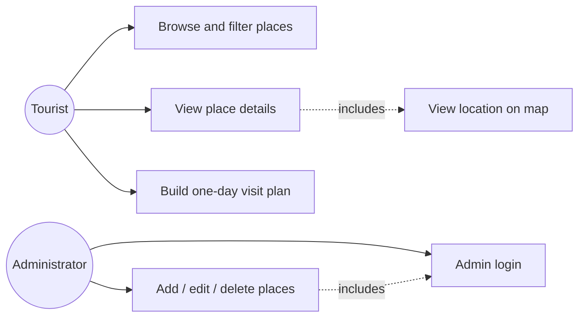
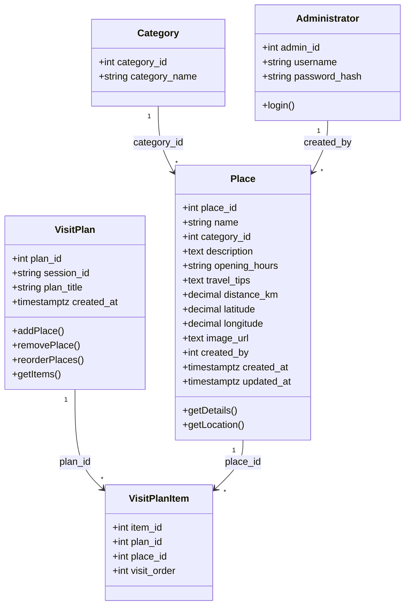
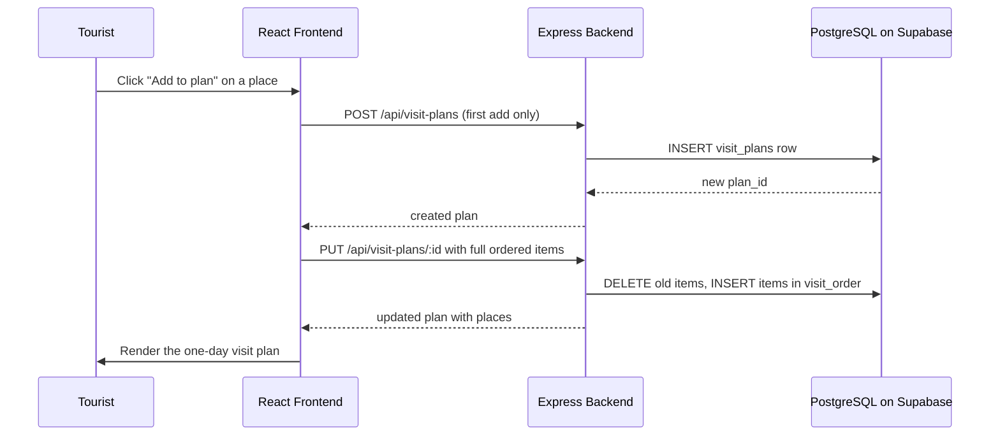
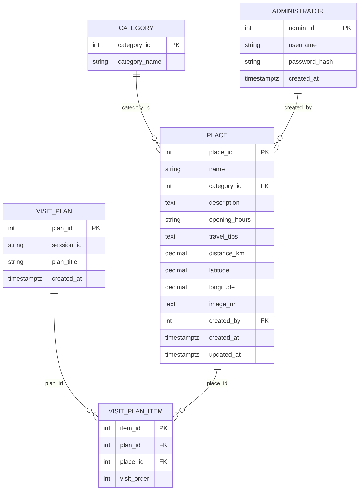

## Software Requirements Specification 

For 

# **Tour -Visit Planner (DayTripGO)** 

_A Web-Based Visit Planning System for Wadduwa and Surrounding Areas_ 

Document Version: 2.1 

Student Name - De Silva P.K.M Registration Number - E2410884 Date: 05.09.2026 

### **Revision History** 

|**Version**|**Date**|**Author**|**Description of Change**|
|---|---|---|---|
|1.0|21.08.2026|P.K.M.DE Silva|Initial draft of SRS based on approved project proposal.|
|2.0|05.09.2026|P.K.M.DE Silva|Final draft of SRS based on Initial and peer review|
|2.1|15.10.2026|P.K.M. De Silva|Corrected typos and appendix numbering; rebuilt §7 traceability; aligned §6 with the implemented schema; replaced garbled figures with Mermaid diagrams.|

### **Table of Contents** 

|Revision History ........................................................................................................................ 2|
|---|
|Table of Contents ....................................................................................................................... 3|
|1.1 Purpose ............................................................................................................................. 5|
|1.2 Document Conventions .................................................................................................... 5|
|1.3 Intended Audience and Reading Suggestions .................................................................. 5|
|1.4 Project Scope ................................................................................................................... 5|
|1.5 References ........................................................................................................................ 6|
|2. Overall Description ................................................................................................................ 6|
|2.1 Product Perspective .......................................................................................................... 6|
|2.2 Product Functions ............................................................................................................ 6|
|2.3 User Classes and Characteristics ..................................................................................... 7|
|2.4 Operating Environment .................................................................................................... 7|
|2.5 Design and Implementation Constraints .......................................................................... 7|
|2.6 User Documentation ........................................................................................................ 8|
|2.7 Assumptions and Dependencies ...................................................................................... 8|
|3. External Interface Requirements ............................................................................................ 8|
|3.1 User Interfaces ................................................................................................................. 8|
|3.2 Hardware Interfaces ......................................................................................................... 9|
|3.3 Software Interfaces .......................................................................................................... 9|
|3.4 Communications Interfaces ............................................................................................. 9|
|4. System Features (Functional Requirements) ................................................................... 10|
|4.1 Place Listing and Category Filtering ............................................................................. 10|
|4.2 Place Detail View .......................................................................................................... 10|
|4.3 Map View....................................................................................................................... 11|
|4.4 One-Day Visit Plan Builder ........................................................................................... 11|
|4.5 Administrator Authentication ........................................................................................ 11|
|4.6 Administrator Place Management.................................................................................. 12|
|5. Non-Functional Requirements ............................................................................................. 12|
|5.1 Performance Requirements ............................................................................................ 12|
|5.2 Safety Requirements ...................................................................................................... 12|
|5.3 Security Requirements ................................................................................................... 12|
|5.4 Software Quality Attributes ........................................................................................... 13|
|5.5 Compliance and Verification Notes ................................................................................ 14|
# Software Requirements Specification 

For 

# **Tour -Visit Planner (DayTripGO)** 

_A Web-Based Visit Planning System for Wadduwa and Surrounding Areas_ 

Document Version: 2.1 

Student Name - De Silva P.K.M Registration Number - E2410884 Date: 05.09.2026 

### **Revision History** 

|**Version**|**Date**|**Author**|**Description of Change**|
|---|---|---|---|
|1.0|21.08.2026|P.K.M.DE Silva|Initial draft of SRS based on approved project proposal.|
|2.0|05.09.2026|P.K.M.DE Silva|Final draft of SRS based on Initial and peer review|
|2.1|15.10.2026|P.K.M. De Silva|Corrected typos and appendix numbering; rebuilt §7 traceability; aligned §6 with the implemented schema; replaced garbled figures with Mermaid diagrams.|

### **Table of Contents** 

|Revision History ........................................................................................................................ 2|
|---|
|Table of Contents ....................................................................................................................... 3|
|1.1 Purpose ............................................................................................................................. 5|
|1.2 Document Conventions .................................................................................................... 5|
|1.3 Intended Audience and Reading Suggestions .................................................................. 5|
|1.4 Project Scope ................................................................................................................... 5|
|1.5 References ........................................................................................................................ 6|
|2. Overall Description ................................................................................................................ 6|
|2.1 Product Perspective .......................................................................................................... 6|
|2.2 Product Functions ............................................................................................................ 6|
|2.3 User Classes and Characteristics ..................................................................................... 7|
|2.4 Operating Environment .................................................................................................... 7|
|2.5 Design and Implementation Constraints .......................................................................... 7|
|2.6 User Documentation ........................................................................................................ 8|
|2.7 Assumptions and Dependencies ...................................................................................... 8|
|3. External Interface Requirements ............................................................................................ 8|
|3.1 User Interfaces ................................................................................................................. 8|
|3.2 Hardware Interfaces ......................................................................................................... 9|
|3.3 Software Interfaces .......................................................................................................... 9|
|3.4 Communications Interfaces ............................................................................................. 9|
|4. System Features (Functional Requirements) ................................................................... 10|
|4.1 Place Listing and Category Filtering ............................................................................. 10|
|4.2 Place Detail View .......................................................................................................... 10|
|4.3 Map View....................................................................................................................... 11|
|4.4 One-Day Visit Plan Builder ........................................................................................... 11|
|4.5 Administrator Authentication ........................................................................................ 11|
|4.6 Administrator Place Management.................................................................................. 12|
|5. Non-Functional Requirements ............................................................................................. 12|
|5.1 Performance Requirements ............................................................................................ 12|
|5.2 Safety Requirements ...................................................................................................... 12|
|5.3 Security Requirements ................................................................................................... 12|
|5.4 Software Quality Attributes ........................................................................................... 13|
|5.1 Safety Requirements ...................................................................................................... 13|
|5.2 Security Requirements ................................................................................................... 13|
|5.3 Software Quality Attributes ........................................................................................... 14|

|6. Data Requirements ............................................................................................................... 14|
|---|
|6.1 Place Entity .................................................................................................................... 15|
|6.2 Category Entity .............................................................................................................. 15|
|6.3 VisitPlan and VisitPlanItem Entities ............................................................................. 15|
|6.4 Administrator Entity ...................................................................................................... 15|
|7. Requirements Traceability ................................................................................................... 16|
|8. Appendices ........................................................................................................................... 17|
|Appendix A: Glossary.......................................................................................................... 17|
|Appendix B: System Diagrams .............................................................................................. 17|
|B.1 Use Case Diagram ......................................................................................................... 17|
|Figure 1: Use Case Diagram for DayTripGO .................................................................. 17|
|B.2 Class Diagram ............................................................................................................... 18|
|Figure 2: Class Diagram for DayTripGO ........................................................................ 18|
|B.3 Sequence Diagram......................................................................................................... 19|
|Figure 3: Sequence Diagram — Build a One-Day Visit Plan ......................................... 19|
|B.4 Entity-Relationship Diagram............................................................................................. 19|
|Figure 4: Entity-Relationship Diagram for DayTripGO .................................................. 20|
|Appendix C: Open Issues..................................................................................................... 21|

#### **1. Introduction** 

###### **1.1 Purpose** 

This Software Requirements Specification (SRS) defines the functional and non-functional requirements for the Local Tourist Day-Visit Planner and Information System, a web-based application that helps tourists discover places of interest within 25 km of Wadduwa, Sri Lanka, and build a simple one day visit plan. This document is intended for the developer, the module supervisor/assessor, and the four consulted stakeholders, and it forms the basis for design, implementation and testing of the system under module ITE2953. 

###### **1.2 Document Conventions** 

Requirements are labelled using the prefixes FR (Functional Requirement) and NFR (Non-Functional Requirement), each followed by a sequential number, e.g. FR-1. The keywords "shall" and "must" indicate mandatory requirements; "should" indicates a desirable but nonmandatory requirement. Priority is expressed using the MoSCoW convention — Essential (Must), Desirable (Should), Optional (Could) — as applied in the tables of Sections 4 and 5. 

###### **1.3 Intended Audience and Reading Suggestions** 

- Developer: primary audience; uses Sections 2–6 for design and implementation guidance. 

- Module Supervisor / Assessor: uses Sections 1–3 to verify the requirements match the approved proposal, and Section 4 to trace testable requirements. 

- Stakeholders (tourist representatives): may review Section 2 (Overall Description) and Section 4 (Functional Requirements) in plain language to confirm their needs have been captured correctly. 

###### **1.4 Project Scope** 

The system scope, as approved in the project proposal, covers: browsing and filtering at least 10 verified places of interest within 25 km of Wadduwa; viewing place details including description, opening times, travel tips and distance; viewing each place on a map; building and viewing a simple one-day visit plan; and an administrator interface for adding, editing and deleting place records. Booking, payment, multi-day itineraries and transport/accommodation reservations are explicitly out of scope. 

###### **1.5 References** 

[1] Project Proposal: "Local Tourist Day-Visit Planner and Information System," ITE2953 Programming Group Project 25S1. 

[2] IEEE Std 830-1998, IEEE Recommended Practice for Software Requirements Specifications (used as the structural template for this document). 

###### **2. Overall Description** 

###### **2.1 Product Perspective** 

The Tourist Day-Visit Planner is a new, standalone web application; it is not a component of, or replacement for, an existing system. It consists of a public tourist-facing interface, a restricted administrator interface, and a shared relational database of places, categories and visit plans. The system depends on a third-party map-embedding service (e.g. Google Maps or OpenStreetMap) to plot place locations, and this is treated as an external interface rather than something built from scratch (see Section 5). 

###### **2.2 Product Functions** 

At a high level, the system provides the following functions, summarised here and detailed as individual requirements in Section 4: 

- List and filter places of interest by category (Tourist). 

- View detailed information for a single place, including a map of its location (Tourist). 

- Add places to, remove places from, and view a one-day visit plan (Tourist). 

- Authenticate as an administrator (Administrator). 

- Create, update and delete place records (Administrator). 

###### **2.3 User Classes and Characteristics** 

|**User Class**|**Description**|**Technical Expertise**|
|---|---|---|
||Domestic or foreign visitor staying in or near Wadduwa who browses|Low to moderate; assumed|
|Tourist|places of interest and builds a one- day visit plan. Primary, unauthenticated user.|familiar with basic web browsing on desktop or mobile.|
||Person responsible for keeping||
||place-of-interest data accurate;|Moderate; comfortable with web|
|Administrator|logs in through a restricted interface to add, edit or delete records.|forms, no coding knowledge required.|

###### **2.4 Operating Environment** 

- Client: modern desktop and mobile web browsers (Chrome, Firefox, Edge, Safari, latest two major versions). 

- Server: Node.js runtime with an Express-based backend (or the module-approved equivalent). 

- Database: PostgreSQL relational database hosted on Supabase. 

- Hosting: development/demo environment suitable for local or low-cost cloud hosting for the duration of the module; production-grade hosting is out of scope. 

###### **2.5 Design and Implementation Constraints** 

- The technology stack must match the stack approved for ITE2953 (see Section 1.4 of the proposal); any deviation requires supervisor approval. 

- The system must be delivered without payment, booking or reservation functionality, per the approved scope. 

- The place dataset must contain a minimum of 10 verified places within 25 km of Wadduwa at the point of submission. 

- Development is carried out by a single student within the timeframe of one academic module, which constrains the depth of testing and the size of the feature set. 

###### **2.6 User Documentation** 

A short user guide (or in-app help text) covering how to filter places, view details, build a oneday plan, and how an administrator logs in and manages records will be delivered alongside the system, in line with standard ITE2953 submission requirements. 

###### **2.7 Assumptions and Dependencies** 

- It is assumed that opening times and travel tips supplied by place owners/authorities do not change frequently enough to require real-time synchronisation. 

- The system depends on an external map-embedding API remaining available and free-touse at the tier required for a student project. 

- It is assumed that the four consulted stakeholders are broadly representative of the primary Tourist user class for the purpose of requirements validation. 

###### **3. External Interface Requirements** 

###### **3.1 User Interfaces** 

- Home, Place Listing page - displays places of interest as a filterable list or grid, with category filter controls. 

- Place Detail page - displays a single place's description, opening times, travel tips, distance from Wadduwa, and an embedded map. 

- Visit Plan page - displays the tourist's currently selected places for a one-day plan, in a single consolidated view. 

- Administrator Login page - a restricted form for administrator authentication. 

- Administrator Dashboard - a form based interface for adding, editing and deleting place records. 

Detailed wireframes/mockups are to be produced in Figma during the design phase and referenced here as figures once available (see List of Figures). 

###### **3.2 Hardware Interfaces** 

No dedicated hardware is required. The system relies on the client device's existing display, input and network hardware; no sensors, printers or other peripherals are used. 

###### **3.3 Software Interfaces** 

|**Interface**|**Type**|**Purpose**|
|---|---|---|
|Map Service API|Third-party web API|Renders an embedded map and marker for each place's location on the Place Detail page.|
|PostgreSQL|Relational database|Stores place, category, visit-plan and|
|Database||administrator account data; accessed by the backend only.|
|Backend REST API|Internal API|Exposes endpoints consumed by the|
|||frontend for listing, filtering, detail retrieval, visit-plan management and|
|||administrator CRUD operations.|

###### **3.4 Communications Interfaces** 

All communication between the client browser and the backend occurs over HTTPS using standard HTTP request/response semantics (REST). No email, messaging, or real-time push protocols are required by the current scope. 

##### **4. System Features (Functional Requirements)** 

This section describes each system feature and its associated functional requirements, grouped by feature area. Priority follows the MoSCoW convention: Essential (Must Have), Desirable (Should Have), Optional (Could Have). 

##### **4.1 Place Listing and Category Filtering** 

Description: Allows a tourist to browse all places of interest and narrow the list down by category (religious, nature, heritage, cultural). 

|**ID**|**Requirement Description**|**Priority**|
|---|---|---|
|FR-1|The system shall display a list of all places of interest on the home page, showing at minimum a photo, name, category and distance from Wadduwa for each place.|Essential|
|FR-2|The system shall allow the tourist to filter the displayed places by one category at a time.|Essential|
|FR-3|The system shall allow the tourist to clear an active filter and return to viewing all places.|Desirable|
|FR-4|The system shall indicate, where available, whether a place is currently open based on its stored opening hours.|Optional|

###### **4.2 Place Detail View** 

Description: Allows a tourist to view full details of a selected place before deciding to add it to a visit plan. 

|**ID**|**Requirement Description**|**Priority**|
|---|---|---|
|FR-5|The system shall display, for a selected place, its description, opening hours, travel tips and distance from Wadduwa.|Essential|
|FR-6|The system shall provide a control that allows the tourist to add the selected place directly to their current one-day visit plan.|Essential|
|FR-7|The system shall display a representative photo of the place on the detail page, where available.|Desirable|

###### **4.3 Map View** 

Description: Allows a tourist to see where a place is located relative to Wadduwa on an interactive map. 

|**ID**|**Requirement Description**|**Priority**|
|---|---|---|
|FR-8|The system shall display the geographic location of a selected place as a marker on an embedded map, using its stored latitude and longitude.|Essential|
|FR-9|The system shall centre and appropriately zoom the map view on the selected place's coordinates.|Desirable|

###### **4.4 One-Day Visit Plan Builder** 

Description: Allows a tourist to collect selected places into a single consolidated plan for a day visit. 

|**ID**|**Requirement Description**|**Priority**|
|---|---|---|
|FR-10|The system shall allow a tourist to add multiple places to a single one-day visit plan.|Essential|
|FR-11|The system shall allow a tourist to remove a previously added place from the visit plan.|Essential|
|FR-12|The system shall display all places currently in the visit plan in one consolidated view.|Essential|
|FR-13|The system shall allow a tourist to reorder the places within their visit plan.|Desirable|

###### **4.5 Administrator Authentication** 

Description: Restricts place-management functionality to authorised administrators only. 

|**ID**||**Requirement Description**|**Priority**|
|---|---|---|---|
|FR-14|The system shall username and management fun|require an administrator to log in with a valid password before accessing any place- ction.|Essential|
|FR-15|The system shall unauthenticated|deny access to administrator functions for any request.|Essential|

###### **4.6 Administrator Place Management** 

Description: Allows an authenticated administrator to keep the catalogue of places accurate and current. 

|**ID**|**Requirement Description**|**Priority**|
|---|---|---|
|FR-16|The system shall allow an authenticated administrator to add a new place record, including name, category, description, opening hours, travel tips, distance, coordinates and an image.|Essential|
|FR-17|The system shall allow an authenticated administrator to edit an existing place record.|Essential|
|FR-18|The system shall allow an authenticated administrator to delete a place record.|Essential|
|FR-19|The system shall validate that all required fields are provided before a place record is saved, and shall display an error message if validation fails.|Desirable|

##### **5. Non-Functional Requirements** 

###### **5.1 Performance Requirements** 

|**ID**|**Requirement Description**|**Priority**|
|---|---|---|
|NFR-1|The system shall load the home page place listing within 3 seconds under normal conditions on a standard 4G mobile connection.|Essential|
|NFR-2|The system shall support at least 50 concurrent users without a noticeable degradation in response time, sufficient for classroom demonstration and evaluation.|Desirable|
|NFR-3|Filtering places by category shall update the displayed list within 1 second of the tourist's selection.|Desirable|

###### **5.2 Safety Requirements** 

|**ID**|**Requirement Description**|**Priority**|
|---|---|---|
|NFR-4|The system shall not provide any functionality that could mislead a tourist into believing a booking, payment or reservation has|Essential|
||been made, since these features are explicitly out of scope.||

###### **5.3 Security Requirements** 

|**ID**|**Requirement Description**|**Priority**|
|---|---|---|
|NFR-5|Administrator passwords shall be stored using a secure hashing algorithm and never stored or transmitted in plain text.|Essential|

|NFR-6|All administrator management endpoints shall verify a valid authentication session before executing any add, edit or delete operation.|Essential|
|---|---|---|
|NFR-7|The system shall not collect or store any personally identifiable information from tourist users, since visit plans are session- based and do not require an account.|Desirable|

###### **5.4 Software Quality Attributes** 

|**ID**|**Requirement Description**|**Priority**|
|---|---|---|
|NFR-8|Usability: A first-time tourist user shall be able to view a place's details and add it to a visit plan within 3 taps/clicks from the home page.|Essential|
|NFR-9|Reliability: The system shall handle a failed data request (e.g., network loss) by displaying a clear error message rather than crashing or showing a blank page.|Desirable|
|NFR-10|Maintainability: The codebase shall be organised into modular, reusable components (frontend) and services (backend) to simplify future feature additions.|Desirable|
|NFR-11|Portability: The system shall be accessible through any modern browser (Chrome, Firefox, Safari, Edge) without requiring installation of additional software.|Essential|
|NFR-12|Scalability: The underlying database schema shall support additional categories or an expanded geographic radius without requiring structural redesign.|Optional|

###### **5.5 Compliance and Verification Notes** 

- Safety: the system handles no payment, medical or safety-critical data; no dedicated safety requirements beyond standard data-handling practice apply (NFR-4). 

- Security: only authenticated administrators may create, edit or delete place records (NFR-6); all administrator authentication traffic shall be transmitted over HTTPS; tourist browsing requires no account and collects no personal data beyond the session-based visit plan (NFR-7). 

- Reliability: core browsing and filtering functions (FR-1–FR-5) shall function correctly for all records in the initial dataset (NFR-9). 

- Portability: the backend shall run on any standard Node.js hosting environment without code changes (NFR-11). 

- Testability: every functional requirement in Section 4 shall map to at least one test case in the system test plan. 

###### **6. Data Requirements** 

The core entities are Place, Category, VisitPlan, VisitPlanItem and Administrator. The Place table, the entity most central to the system, is detailed below as an example; the remaining entities are listed briefly below and are fully defined in the entity-relationship diagram of Appendix B, Figure 4. 

###### **6.1 Place Entity** 

|**Field**|**Type / Constraint**|**Description**|
|---|---|---|
|**place_id**|INT, PK, auto-increment|Unique identifier for a place.|
|**name**|VARCHAR(150), NOT NULL|Name of the place of interest.|
|**category_id**|INT, FK -> category.category_id|Links the place to a category.|
|**description**|TEXT, NOT NULL|Descriptive text shown on the detail page.|
|**opening_hours**|VARCHAR(100)|Opening times, free text (e.g. "6:00 AM – 8:00 PM daily").|
|**travel_tips**|TEXT|Practical tips for visiting.|
|**distance_km**|DECIMAL(4,1), NOT NULL|Approximate distance from Wadduwa in kilometres.|
|**latitude**|DECIMAL(9,6), NOT NULL|Latitude used for map display.|
|**longitude**|DECIMAL(9,6), NOT NULL|Longitude used for map display.|
|**image_url**|TEXT, NULL|URL of a representative photo (FR-7); optional.|
|**created_by**|INT, FK -> administrator.admin_id|Administrator who created the record.|
|**created_at**|DATETIME|Record creation timestamp.|
|**updated_at**|DATETIME|Record last-updated timestamp.|

###### **6.2 Category Entity** 

- category_id (INT, PK, auto-increment) 

- category_name (VARCHAR(50), NOT NULL, UNIQUE) — e.g. Nature, Religious, Heritage, Cultural 

###### **6.3 VisitPlan and VisitPlanItem Entities** 

- VisitPlan: plan_id (PK), session_id (browser-session token), plan_title (default "My One-Day Plan"), created_at. 

- VisitPlanItem: item_id (PK), plan_id (FK), place_id (FK), visit_order — links selected places to a plan in a chosen order (FR-13). 

###### **6.4 Administrator Entity** 

- admin_id (PK), username (UNIQUE, NOT NULL), password_hash (NOT NULL), created_at 

###### **7. Requirements Traceability** 

This table maps each project objective from the approved proposal to the requirement(s) in this SRS that realise it, to support verification that the SRS is complete relative to the proposal. 

|**Project Objective**|**Related Requirement(s)**|
|---|---|
|**Identify ≥10 verified places within 25 km of** **Wadduwa**|FR-1, FR-4, Section 6.1|
|**Elicit and validate requirements through** **stakeholder consultation**|Section 2.3, Appendix A (proposal)|
|**Design a relational database and system architecture**|Section 2.1, Section 6|
|**Implement viewing, filtering and mapping of places**|FR-1–FR-9|
|**Implement a one-day visit-plan builder**|FR-10–FR-13|
|**Implement administrator authentication and place** **add/edit/delete functionality**|FR-14–FR-19|

###### **8. Appendices** 

###### **Appendix A: Glossary** 

|**Term**|**Definition**|
|---|---|
|**Place of interest**|A location (religious, nature, heritage or cultural site) documented|
||in the system for tourists to view and plan visits to.|
|**Visit plan**|A tourist's selected, ordered set of places forming a single day's|
||itinerary within the system.|
|**Administrator**|An authenticated user role responsible for maintaining place data.|

###### **Appendix B: System Diagrams** 

##### **B.1 Use Case Diagram** 

Figure 1 shows the two actors of the system Tourist and Administrator and the use cases each can perform. "View Place Details" includes "View Location on Map" since a place's map location is always shown as part of its detail view. All Administrator place-management use cases include "Admin Login", since authentication is required before any management action. 

**_Figure 1: Use Case Diagram for DayTripGO_** 

###### **B.2 Class Diagram** 

Figure 2 shows the main classes in the system, their key attributes and methods, and the relationships between them, consistent with the entity-relationship diagram in Section 6. 

**_Figure 2: Class Diagram for DayTripGO_** 

##### **B.3 Sequence Diagram** 

Figure 3 illustrates the interaction between the Tourist, the frontend UI, the backend services and the database for the "Build One-Day Visit Plan" use case (UC-05), from selecting a place through to the visit plan being updated. 

**_Figure 3: Sequence Diagram — Build a One-Day Visit Plan_** 

##### **B.4 Entity-Relationship Diagram** 

The system uses a relational database (PostgreSQL, hosted on Supabase) with five core entities: Category, Place, VisitPlan, VisitPlanItem and Admin. Category has a one-to-many relationship with Place. VisitPlan and Place have a many-to-many relationship, resolved through the VisitPlanItem join entity, which also stores the visit order for the reordering feature (FR-13). Admin has a one-to-many relationship with Place via `created_by`, recording which administrator created a given record. 

**_Figure 4: Entity-Relationship Diagram for DayTripGO_** 

###### **Entity Descriptions** 

|**Entity**|**Purpose**|
|---|---|
|Category|Stores the fixed set of place categories (religious, nature, heritage, cultural) used for filtering.|
|Place|Stores each place of interest's descriptive, locational and operational details.|
|VisitPlan|Represents a single tourist's one-day visit plan, identified by a browser session rather than a user account.|
|VisitPlanItem|Join entity linking a VisitPlan to the Places selected for it, including their visit order.|
|Admin|Stores administrator login credentials and identifies who manages each Place record.|

###### **Appendix C: Open Issues (Resolved)** 

All open issues raised in version 2.0 have been resolved (15.10.2026): 

- **Technology stack** — confirmed as Node.js + Express with PostgreSQL hosted on Supabase (proposal §1.8); the PHP alternative is not used. 

- **Kosgoda Sea Turtle Conservation Project** — excluded from the final dataset; the ten seeded places all sit within 25 km of Wadduwa (risk R-04). 

- **Map-embedding API** — resolved in favour of OpenStreetMap with Leaflet (free, no usage quota for a student project). 

