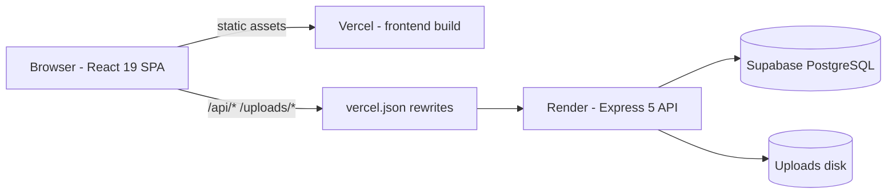

<h1 align="center">DayTripGO - Visit Planner &amp; Information System</h1>

<p align="center">
  A local tourism guide and day trip planner for the Wadduwa area of Sri Lanka -<br>
  verified places within 25&nbsp;km, opening times, practical details, and a simple one-day visit plan.
</p>

<p align="center">
  <a href="https://day-trip-go-visit-planner-and-infor.vercel.app"><strong>Live website</strong></a> ·
  <a href="https://daytripgo-visit-planner-and-information.onrender.com/api/health"><strong>API health</strong></a> ·
  <a href="E2410884_SRS%20DOCUMENT_FINAL.md"><strong>SRS</strong></a> ·
  <a href="E2410884_PROJECT_PLAN.md"><strong>Project plan</strong></a>
</p>

---

## Table of contents

- [Overview](#overview)
- [Screenshots](#screenshots)
  - [Public website](#public-website)
  - [Admin panel](#admin-panel)
- [Full functionality](#full-functionality)
- [Stack & architecture](#stack--architecture)
- [Project structure](#project-structure)
- [Getting started](#getting-started)
- [REST API](#rest-api)
- [Database schema](#database-schema)
- [Testing](#testing)
- [Deployment](#deployment)
- [Documentation](#documentation)

---

## Overview

DayTripGO is a three-tier web application:

| Tier | What it does |
| --- | --- |
| **Presentation** | React single-page app (Vite + Tailwind CSS v4) with public site, business-owner portal, and admin panel |
| **Application** | Express 5 REST API - JWT auth, validation, photo uploads, caching, morgan logging |
| **Data** | Supabase (hosted PostgreSQL) for all business data + server disk for uploaded photos |

Three kinds of users share one codebase:

1. **Visitors** browse verified places, filter by category, and build a one-day plan with live route distances on a map.
2. **Business owners** register and submit their own listings (with photo galleries) for admin approval.
3. **The admin** manages every place, moderates owner listings, edits page content, and answers contact messages.

---

## Screenshots

### Public website

| Home - hero | Home - featured escapes | Home - top places |
| :---: | :---: | :---: |
|  |  |  |
| <sub>Hero with category CTAs</sub> | <sub>Featured escapes carousel</sub> | <sub>Top places + footer</sub> |

| Explore places | My Day Plan | Contact us |
| :---: | :---: | :---: |
|  |  |  |
| <sub>Category filters, place cards, add-to-plan</sub> | <sub>Route summary, drag-reorder, Leaflet map</sub> | <sub>Contact form + company details</sub> |

### Admin panel

| Dashboard | Place editor |
| :---: | :---: |
|  |  |
| <sub>Stats: places, categories, plans, messages, server storage</sub> | <sub>Place CRUD with opening hours, covers, featured toggle</sub> |

---

## Full functionality

### 🧭 Public website (visitors - no account needed)

- **Home** - hero, “Featured escapes” carousel (up to 12 admin-picked places), “Top places to visit”, category entry points, and admin-editable per-page content.
- **Explore** - every published place in one grid, category filters (Religious / Nature / Heritage / Cultural), opening hours, and *Add to plan* straight from the card.
- **Place detail** - photo gallery, description, opening hours, distance-from-Wadduwa, Google Maps link, and add-to-plan.
- **My Day Plan** - add / remove / drag-reorder stops, set a starting point (typed or geolocated), **route summary** (total distance, driving time, stop count) computed over the road network, live route drawn on a Leaflet map, plan persisted to the backend, and a “Open in Google Maps” hand-off.
- **Contact us** - validated message form; messages land in the admin’s *Contact responses* inbox.
- **Business CTA** - public registration/login entry points for owners.

### 🏢 Business owner portal (`/owner/*`)

- Register, login, logout, profile editing, password change (separate JWT from the admin token).
- Create / edit / delete own listings with details, categories, tags, and photo galleries.
- Photo roles: Explore card cover and “Featured escapes” cover, with a server-side storage quota gate.
- Listings appear publicly only after the admin approves (publish) them.

### 🛠 Admin panel (`/admin/*`)

- **Dashboard** - site statistics (places, categories, plans created, unread messages) and server-storage usage.
- **Attractive Places** - full CRUD modal with opening hours, notes, description, cover photos, “Featured escapes” placement, and publish/unpublish.
- **Businesses** - review owner submissions: approve, unpublish, or delete; manage business tags.
- **Edit pages** - per-page content editors for Home, Explore, My Day Plan, and Contact (text sections + hero covers).
- **Contact responses** - read / mark read / delete visitor messages.

---

## Stack & architecture



| Layer | Technology |
| --- | --- |
| UI | **React 19**, **Vite 8**, **Tailwind CSS v4**, shadcn/Base UI components, lucide & Tabler icons |
| Routing | **react-router-dom v7** (public, `/owner/*`, `/admin/*` route groups with protected layouts) |
| Maps & routes | **Leaflet** + **react-leaflet** + **leaflet-routing-machine** (OpenStreetMap) |
| Motion & carousels | framer-motion / motion, embla-carousel |
| HTTP | **axios** (relative `/api` base, JWT interceptors for admin & owner tokens) |
| Backend | **Node.js + Express 5** (CommonJS), **JWT**, **bcryptjs**, **multer** uploads, **morgan** logging, **cors**, **dotenv** |
| Database | **Supabase** (hosted PostgreSQL) via `@supabase/supabase-js`, TTL cache on public lists |
| Testing | **Vitest** + Testing Library, **Jest** + Supertest, **Playwright** smoke, **autocannon** load |
| Linting | oxlint |
| Hosting | **Vercel** (frontend), **Render** (API), **Supabase** (database) |

### Project structure

```
DayTripGo-Visit-Planner-and-Information-System/
├── frontend/          # React SPA - src/{pages,components,services,hooks,context}
│                      #   vite.config.js proxies /api and /uploads → localhost:5000 in dev
│                      #   vercel.json forwards them to Render in production
├── backend/           # Express REST API - src/{routes,controllers,services,models,middleware}
│                      #   uploads/ holds admin/owner uploaded photos (served at /uploads)
├── database/
│   ├── schema/        # 001…010 SQL migrations (run in order)
│   └── seeds/         # categories, places, google-maps links, business categories
├── docs/              # integration logs + testing plan & guides
├── tests/
│   ├── smoke/         # Playwright end-to-end smoke suite
│   └── load/          # autocannon load tests (writes JSON reports)
├── SS/                # screenshots used by this README
└── package.json       # repo-level test tooling (test:smoke, test:load)
```

---

## Getting started

### Prerequisites

- **Node.js 20+** and npm
- A **Supabase** project (free tier is fine)

### 1. Database

Run the SQL files in the Supabase SQL editor, in order:

1. `database/schema/001_create_tables.sql` … `010_business_photos.sql`
2. `database/seeds/001_seed_categories.sql` … `004_seed_business_categories.sql`

### 2. Backend

```bash
cd backend
npm install
```

Create `backend/.env`:

```env
PORT=5000
JWT_SECRET=change-me
JWT_EXPIRES_IN=24h
ADMIN_USERNAME=admin
ADMIN_PASSWORD=change-me
SUPABASE_URL=https://<project>.supabase.co
SUPABASE_SECRET_KEY=<service-role secret>
```

```bash
npm run dev     # nodemon → http://localhost:5000
npm start       # plain node
```

Health check: <http://localhost:5000/api/health>

### 3. Frontend

```bash
cd frontend
npm install
npm run dev     # Vite → http://localhost:5173
```

Vite proxies `/api` and `/uploads` to `localhost:5000` (see `frontend/vite.config.js`), so no env file is needed in development.

```bash
npm run build   # production bundle → dist/
npm run test    # vitest unit tests
npm run lint    # oxlint
```

### 4. Repository test tooling

```bash
npm install           # repo root (Playwright + autocannon)
npm run test:smoke    # Playwright smoke suite - needs frontend + backend running
npm run test:load     # autocannon load test - spawns its own backend if needed
```

---

## REST API

Base URL: `http://localhost:5000` (dev) - all routes under `/api`.

| Method & path | Auth | Purpose |
| --- | --- | --- |
| `GET /api/health` | - | Service health check |
| `GET /api/categories` | - | Place categories |
| `GET /api/places` · `GET /api/places/:id` | - / admin scope | Public place list (published only) & detail |
| `POST/PUT/DELETE /api/places[/:id]` | admin JWT | Place CRUD |
| `PUT /api/places/:id/publish` | admin JWT | Publish / unpublish |
| `GET/POST/DELETE /api/places/:id/photos…` | admin JWT | Photo gallery, primary photo, uploads |
| `POST/GET/PUT /api/visit-plans[/:id]` | - | Save / read / update a visitor's day plan |
| `POST /api/auth/login` · `/logout` | admin JWT on logout | Admin login |
| `POST /api/owner/auth/register` · `/login` · `/logout` | owner JWT | Owner registration & sessions |
| `GET/PUT /api/owner/auth/me` · `PUT /password` | owner JWT | Profile & password |
| `GET /api/businesses` · `GET /api/businesses/:id` | - | Public listings (approved only) |
| `POST/PUT/DELETE /api/businesses[/:id]` | owner JWT | Owner listing CRUD |
| `GET/POST/PUT/DELETE /api/businesses/:id/photos…` | owner JWT | Listing photos (quota-gated) |
| `PUT /api/businesses/:id/publish` · `DELETE /admin/:id` | admin JWT | Moderation |
| `GET/POST/PUT/DELETE /api/business-tags[/:id]` | public read / admin write | Business tags |
| `GET /api/admin/stats` | admin JWT | Dashboard statistics |
| `GET/PUT /api/content/:page` · `POST /cover` | public read / admin write | Page content & hero covers |
| `POST /api/messages` | - | Contact form submission |
| `GET /api/messages` · `PATCH /:id/read` · `DELETE /:id` | admin JWT | Contact responses |

Conventions: JSON envelope `{ success, count, data }` (or `{ success, message }`), admin JWTs and owner JWTs are separate so tokens can never cross, and validation errors come back through the central error handler.

---

## Database schema

| Table | Purpose |
| --- | --- |
| `categories` | Religious, Nature, Heritage, Cultural |
| `places` | Place records (description, hours, coordinates, published flag, distance) |
| `place_photos` | Place gallery; primary photo syncs to `places.image_url` |
| `visit_plans` · `visit_plan_items` | Saved visitor day plans and their ordered stops |
| `admins` | Admin accounts (plus env-based fallback login) |
| `contact_messages` | Contact form submissions |
| `page_content` | Per-page editable content (Home / Explore / My Day Plan / Contact) |
| `business_owners` | Owner accounts |
| `businesses` · `business_tags` · `business_photos` | Owner listings, tags, galleries |
| `business_categories` | Categories for business listings |

Schema lives in `database/schema/` as ordered, idempotent SQL (`create table if not exists`), seeds in `database/seeds/`.

---

## Testing

| Layer | Tool | Command |
| --- | --- | --- |
| Unit (frontend) | Vitest + Testing Library | `cd frontend && npm test` |
| Unit / integration / API (backend) | Jest + Supertest | `cd backend && npm test` |
| End-to-end smoke | Playwright | `npm run test:smoke` (repo root) |
| Load | autocannon | `npm run test:load` (repo root) |

Detailed plans and results: [`docs/testing/`](docs/testing/TESTING-PLAN.md) - unit, integration, API, smoke, and load testing guides, plus recorded load reports in `tests/load/reports/`.

---

## Deployment

| Piece | Host | Notes |
| --- | --- | --- |
| Frontend | **Vercel** | Root directory `frontend`, build `vite build`, output `dist` - <https://day-trip-go-visit-planner-and-infor.vercel.app> |
| Backend | **Render** | Start command `npm start` (`node src/server.js`) - <https://daytripgo-visit-planner-and-information.onrender.com> |
| Database | **Supabase** | Hosted PostgreSQL |

Because the SPA calls the API with a **relative** `/api` base, production traffic is forwarded by rewrites in [`frontend/vercel.json`](frontend/vercel.json):

```json
{
  "rewrites": [
    { "source": "/api/:path*",     "destination": "https://daytripgo-visit-planner-and-information.onrender.com/api/:path*" },
    { "source": "/uploads/:path*", "destination": "https://daytripgo-visit-planner-and-information.onrender.com/uploads/:path*" },
    { "source": "/((?!api/|uploads/).*)", "destination": "/index.html" }
  ]
}
```

That keeps the browser same-origin (no CORS configuration needed), proxies uploaded photos, and gives deep links an SPA fallback.

> **Note:** on free tiers the Render service sleeps after inactivity - the first request can take 30–60 s while it wakes up.

---

## Documentation

| Document | Contents |
| --- | --- |
| [`E2410884_SRS DOCUMENT_FINAL.md`](E2410884_SRS%20DOCUMENT_FINAL.md) | Software requirements specification |
| [`E2410884_PROJECT_PLAN.md`](E2410884_PROJECT_PLAN.md) | Project plan |
| [`ITE2953_ProjectProposal_E2410884.md`](ITE2953_ProjectProposal_E2410884.md) | Project proposal |
| [`daytripgo-ui-ux-design-guide.md`](daytripgo-ui-ux-design-guide.md) | UI/UX design guide |
| [`docs/integration-log.md`](docs/integration-log.md) | Integration log (round by round) |
| [`docs/integration-log-business-owner-portal.md`](docs/integration-log-business-owner-portal.md) | Owner portal integration log |
| [`docs/testing/`](docs/testing/TESTING-PLAN.md) | Testing plan, test reports, and guides |

PDF versions of the proposal and SRS live on the [`Documents`](https://github.com/KMDS21/DayTripGo-Visit-Planner-and-Information-System/tree/Documents) branch.

---

<p align="center">
  Built for <strong>ITE2953</strong> · P.K.M. De Silva (E2410884) · Wadduwa, Sri Lanka<br>
  <sub>Visit planning only - no booking or payment services.</sub>
</p>
