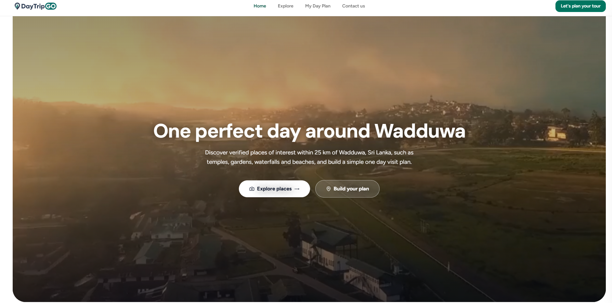
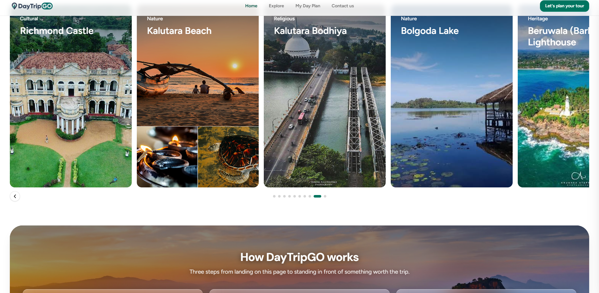
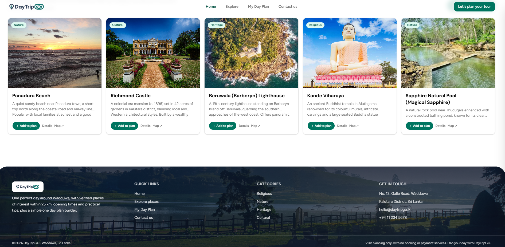
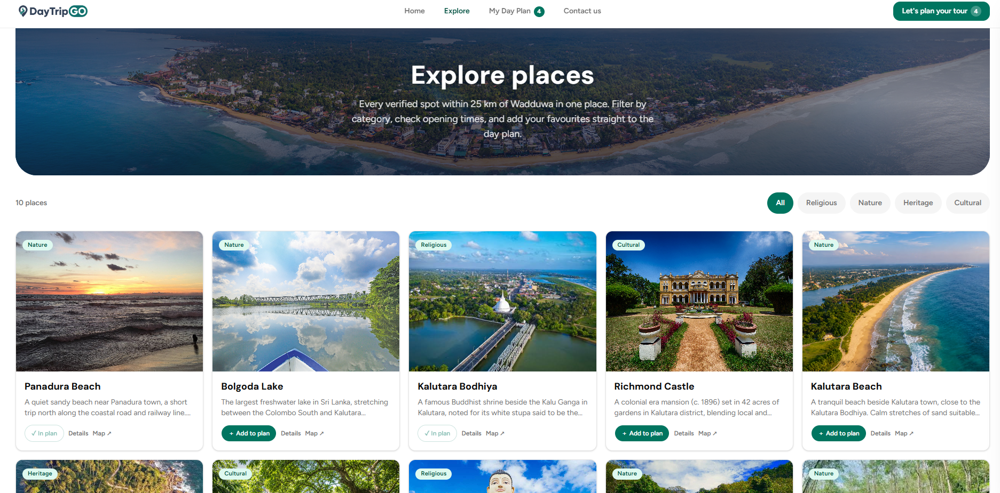
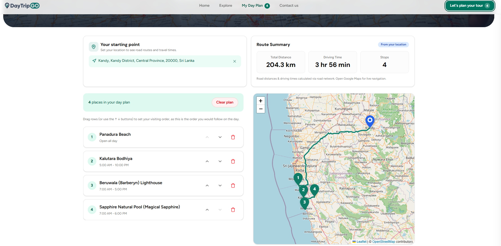
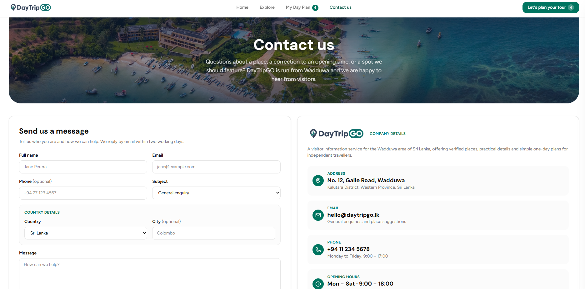
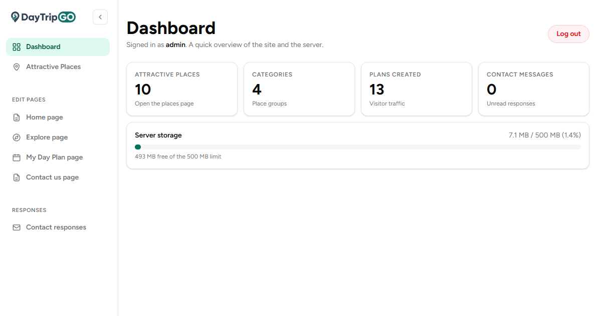
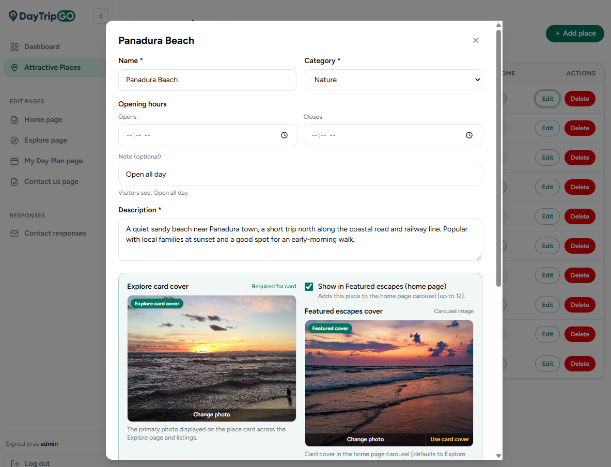

  <a href="https://day-trip-go-visit-planner-and-infor.vercel.app"><strong>Live website</strong></a> ·
  <a href="https://daytripgo-visit-planner-and-information.onrender.com/api/health"><strong>API health</strong></a> ·
  <a href="https://github.com/KMDS21/DayTripGo-Visit-Planner-and-Information-System"><strong>Main branch</strong></a>

> The full technical README - stack, architecture, features, REST API, database schema, testing, and deployment - lives in the [`main`](https://github.com/KMDS21/DayTripGo-Visit-Planner-and-Information-System/blob/main/README.md) branch.

---

## 📄 Documents on this branch

| Document | Format | Contents |
| --- | --- | --- |
| [Project Introduction and Problem Specification.pdf](Project%20Introduction%20and%20Problem%20Specification.pdf) | PDF | Project background, problem statement, and objectives |
| [ITE2953_ProjectProposal_E2410884.docx](ITE2953_ProjectProposal_E2410884.docx) | Word | Project proposal (ITE2953) |
| [E2410884_SRS DOCUMENT.pdf](E2410884_SRS%20DOCUMENT.pdf) | PDF | Software requirements specification |
| [E2410884_SRS DOCUMENT_FINAL.pdf](E2410884_SRS%20DOCUMENT_FINAL.pdf) | PDF | Software requirements specification - final version |

Markdown sources (project plan, proposal, SRS, UI/UX guide, integration and testing logs) are kept in the [`main`](https://github.com/KMDS21/DayTripGo-Visit-Planner-and-Information-System/tree/main) branch.

---

## Screenshots

### Public website

| Home - hero | Home - featured escapes | Home - top places |
| :---: | :---: | :---: |
|  |  |  |
| Hero with category CTAs | Featured escapes carousel | Top places + footer |

| Explore places | My Day Plan | Contact us |
| :---: | :---: | :---: |
|  |  |  |
| Category filters, place cards, add-to-plan | Route summary, drag-reorder, Leaflet map | Contact form + company details |

### Admin panel

| Dashboard | Place editor |
| :---: | :---: |
|  |  |
| Stats: places, categories, plans, messages, server storage | Place CRUD with opening hours, covers, featured toggle |

---

## System at a glance

| Layer | Technology |
| --- | --- |
| Frontend | React 19 · Vite 8 · Tailwind CSS v4 · react-router-dom 7 · Leaflet maps - hosted on **Vercel** |
| Backend | Node.js · Express 5 · JWT · bcryptjs · multer uploads - hosted on **Render** |
| Database | Supabase (hosted PostgreSQL) |
| Testing | Vitest · Jest + Supertest · Playwright smoke · autocannon load |

Three user roles: **visitors** browse places and build one-day plans, **business owners** submit listings with photo galleries, and the **admin** moderates content, edits pages, and answers messages.

---

  Built for <strong>ITE2953</strong> · P.K.M. De Silva (E2410884) · Wadduwa, Sri Lanka

